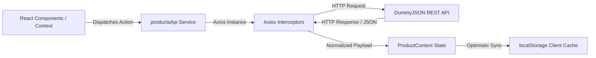

# Third-Party REST API Integration Guide

## 1. Executive Overview

The **Dynamic Role-Based Access Management System** integrates with the public **DummyJSON REST API** (`https://dummyjson.com/products`) to provide enterprise-grade Product Catalog and Inventory CRUD operations.

The client architecture leverages **Axios** with structured request/response interceptors, robust error handling, runtime schema validation, pagination, and local persistence synchronization to provide an uninterrupted offline-first developer experience.

---

## 2. API Architecture & Endpoint Specification

* **Base URL**: `https://dummyjson.com`
* **Protocol**: HTTPS / RESTful JSON
* **Timeout**: 10,000 ms



### Supported API Endpoints

| Operation | HTTP Method | Endpoint | Query / Payload | Description |
| :--- | :--- | :--- | :--- | :--- |
| **List Products** | `GET` | `/products` | `?limit=100&skip=0&sortBy=title&order=asc` | Retrieves paginated collection of products. |
| **Search Products** | `GET` | `/products/search` | `?q={query}&limit=100` | Filters products matching title, description, or brand. |
| **Filter by Category** | `GET` | `/products/category/{category}` | `?limit=100` | Fetches items belonging to a specific department. |
| **List Categories** | `GET` | `/products/categories` | _None_ | Retrieves all product category slugs. |
| **Get Single Product**| `GET` | `/products/{id}` | _None_ | Fetches full specification (reviews, dimensions, warranty). |
| **Create Product** | `POST` | `/products/add` | JSON Payload (Product schema) | Submits newly curated item to the catalog. |
| **Update Product** | `PUT` | `/products/{id}` | JSON Payload (Updated fields) | Updates existing product details. |
| **Delete Product** | `DELETE` | `/products/{id}` | _None_ | Removes product from central catalog. |

---

## 3. Data Payloads & Schemas

### 3.1. Request Payload: Create Product (`POST /products/add`)

```json
{
  "title": "Ultra Wireless Noise Canceling Headphones",
  "category": "smartphones",
  "price": 299.99,
  "stock": 25,
  "brand": "Enterprise Sound",
  "rating": 4.8,
  "discountPercentage": 12.5,
  "description": "High-fidelity acoustics engineered for modern enterprise environments.",
  "thumbnail": "https://images.unsplash.com/photo-1505740420928-5e560c06d30e"
}
```

### 3.2. Response Payload: Create Product (`200 OK`)

```json
{
  "id": 195,
  "title": "Ultra Wireless Noise Canceling Headphones",
  "category": "smartphones",
  "price": 299.99,
  "stock": 25,
  "brand": "Enterprise Sound",
  "rating": 4.8,
  "discountPercentage": 12.5,
  "description": "High-fidelity acoustics engineered for modern enterprise environments.",
  "thumbnail": "https://images.unsplash.com/photo-1505740420928-5e560c06d30e"
}
```

### 3.3. Response Payload: Full Product Specification (`GET /products/{id}`)

```json
{
  "id": 1,
  "title": "Essence Mascara Lash Princess",
  "description": "The Essence Mascara Lash Princess is a popular mascara known for volumizing effects...",
  "category": "beauty",
  "price": 9.99,
  "discountPercentage": 7.17,
  "rating": 4.94,
  "stock": 5,
  "tags": ["beauty", "mascara"],
  "brand": "Essence",
  "sku": "RCH45Q1A",
  "weight": 2,
  "dimensions": {
    "width": 23.17,
    "height": 14.43,
    "depth": 28.01
  },
  "warrantyInformation": "1 month warranty",
  "shippingInformation": "Ships in 1 month",
  "availabilityStatus": "Low Stock",
  "reviews": [
    {
      "rating": 2,
      "comment": "Very unhappy with my purchase!",
      "date": "2024-05-23T08:56:21.618Z",
      "reviewerName": "John Doe",
      "reviewerEmail": "john.doe@x.dummyjson.com"
    }
  ],
  "returnPolicy": "30 days return policy",
  "minimumOrderQuantity": 24,
  "meta": {
    "barcode": "9164035102868",
    "qrCode": "https://assets.dummyjson.com/public/qr-code.png"
  },
  "images": [
    "https://cdn.dummyjson.com/products/images/beauty/Essence%20Mascara%20Lash%20Princess/1.png"
  ],
  "thumbnail": "https://cdn.dummyjson.com/products/images/beauty/Essence%20Mascara%20Lash%20Princess/thumbnail.png"
}
```

---

## 4. Implementation Details

### 4.1. Axios Client Configuration ([`src/api/axiosClient.js`](file:///f:/dynamic-rbac-system/src/api/axiosClient.js))

The Axios client defines standardized headers and response transforms:

```javascript
import axios from 'axios';

const apiClient = axios.create({
  baseURL: 'https://dummyjson.com',
  timeout: 10000,
  headers: {
    'Content-Type': 'application/json',
    Accept: 'application/json',
  },
});

apiClient.interceptors.response.use(
  (response) => response,
  (error) => {
    let friendlyMessage = 'An unexpected error occurred while communicating with the catalog service.';
    if (error.response) {
      friendlyMessage = error.response.data?.message || `API Error: ${error.response.status} ${error.response.statusText}`;
    } else if (error.request) {
      friendlyMessage = 'Could not establish connection to the remote catalog service. Please verify your internet connection.';
    }
    return Promise.reject(new Error(friendlyMessage));
  }
);

export default apiClient;
```

### 4.2. Local Store Synchronization & Hybrid Merging

Because DummyJSON simulates mutations in-memory without persisting them upstream to their remote database, the client employs a **Hybrid Sync Engine** in [`ProductContext.jsx`](file:///f:/dynamic-rbac-system/src/context/ProductContext.jsx):

1. **Creates (`POST`)**: Newly created products receive a unique synthetic ID (`Date.now()`), flagged with `isCustom: true`, and stored in `localStorage.getItem('rbac_custom_products')`.
2. **Updates (`PUT`)**: Modified items are overlaid onto the server records via `localStorage.getItem('rbac_updated_products')`.
3. **Deletions (`DELETE`)**: Deleted IDs are kept in a suppression set in `localStorage.getItem('rbac_deleted_product_ids')`.
4. **Hydration**: When `fetchProducts()` runs, server items are merged with local created/updated records and filtered against deleted IDs, ensuring complete persistence across user sessions and page reloads.

---

## 5. Error Handling & Edge Cases

* **Network Timeouts**: Interceptors detect dropped connections and surface empathetic toast messages via `ToastContext`.
* **Deleted Mock IDs**: DummyJSON returns 404 when querying an ID that doesn't exist remotely; the client falls back seamlessly to the locally cached version.
* **Rate Limits**: The client queries `/products?limit=100` once during startup, caching records and calculating client-side pagination, sorting, and multi-field search to minimize network requests.

