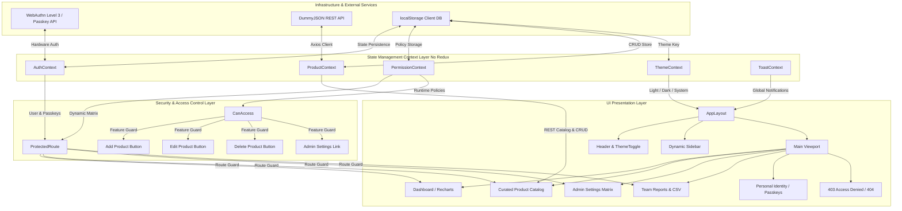
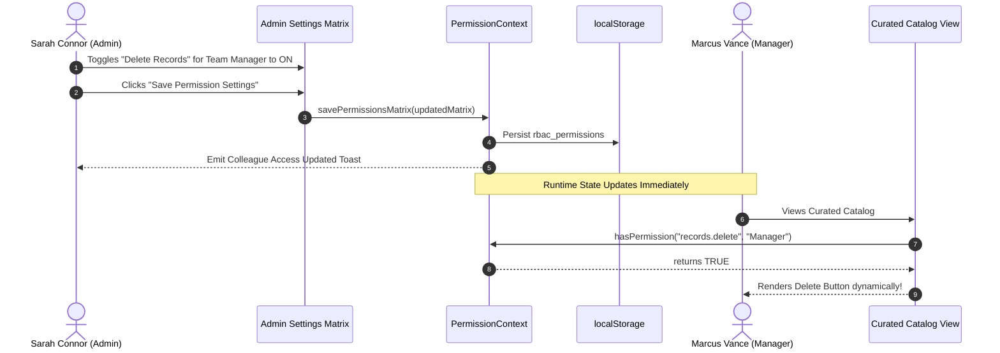

# System Architecture & Technical Topology

## 1. Architectural Philosophy

The **Dynamic Role-Based Access Management System** is built on an enterprise React frontend architecture designed for performance, modularity, and strict separation of concerns.

### Core Architectural Decisions
* **Strictly No Redux**: Pure **React Context API** is utilized across 5 specialized domain contexts, minimizing boilerplate while guaranteeing atomic, fine-grained state updates.
* **Dynamic Runtime RBAC**: Access controls are never hardcoded in route declarations or component JSX; all checks evaluate policies at runtime against an Admin-managed permission matrix.
* **Component-Level & Route-Level Security**: Dual-layer authorization using `<ProtectedRoute>` (URL tampering prevention) and `<CanAccess>` (granular feature/button visibility).
* **Multi-Modal WebAuthn Authentication**: FIDO2 Level 3 biometric credentials (Windows Hello Face, Fingerprint) alongside fallback password authentication.
* **Theme System**: Zero-FOUC (Flash of Unstyled Content) dark/light theme switching with native OS preference auto-detection and multi-tab state broadcasting.

---

## 2. High-Level System Architecture Diagram

---

## 3. Layered Module Topology

### 3.1. Layer 1: Presentation & Design System
* **Atomic Components** ([`src/components/common/`](file:///f:/dynamic-rbac-system/src/components/common/)):
  * `Button`: Primary, secondary, outline, ghost, danger, and dark variants with loading spinners and human icon support.
  * `Badge`: Role-tier indicators (`Admin`, `Manager`, `Employee`) and semantic status pills.
  * `Card`: Standardized container with title, subtitle, header actions, and dark mode borders.
  * `Modal` & `ConfirmModal`: Accessible dialogs with escape-key handling and focus traps.
  * `Input` & `Select`: Form controls with built-in validation states, helper text, and icons.
  * `Toggle`: Accessible switch control for runtime permission management.
  * `Pagination`: Page count, page jump, and dynamic page size controls.
  * `Skeleton`: Animated shimmering placeholders for loading states.

### 3.2. Layer 2: Security & Governance Guards
* **`ProtectedRoute`** ([`src/components/rbac/ProtectedRoute.jsx`](file:///f:/dynamic-rbac-system/src/components/rbac/ProtectedRoute.jsx)):
  * Sits at the React Router configuration boundary.
  * Inspects `isAuthenticated` and checks `hasPermission(requiredPermission, userRole)`.
  * If unauthorized, intercepts navigation and redirects to `/access-denied` with diagnostic metadata (`path`, `requiredPolicy`, `userRole`).
* **`CanAccess`** ([`src/components/rbac/CanAccess.jsx`](file:///f:/dynamic-rbac-system/src/components/rbac/CanAccess.jsx)):
  * Inline permission guard for actionable UI elements (buttons, menus, forms).
  * Can either hide elements completely or render them disabled with a tooltip explaining which permission is required.

### 3.3. Layer 3: React Context Domain State (No Redux)
1. **`AuthContext`** ([`src/context/AuthContext.jsx`](file:///f:/dynamic-rbac-system/src/context/AuthContext.jsx)):
   * Manages active user session, pre-configured accounts, login history, passkey registrations, and quick role switching.
2. **`PermissionContext`** ([`src/context/PermissionContext.jsx`](file:///f:/dynamic-rbac-system/src/context/PermissionContext.jsx)):
   * Stores the dynamic permissions matrix mapping roles to feature keys.
   * Exposes `hasPermission(permissionKey, role)`, `savePermissionsMatrix(newMatrix)`, and `resetToDefaults()`.
   * Automatically synchronizes updates to active client sessions in real time.
3. **`ProductContext`** ([`src/context/ProductContext.jsx`](file:///f:/dynamic-rbac-system/src/context/ProductContext.jsx)):
   * Orchestrates third-party REST API communications.
   * Manages client-side pagination, multi-attribute search, department filtering, and sorting.
   * Computes analytical aggregates (stock valuations, supply distributions, growth projections) for Recharts visualizations.
4. **`ThemeContext`** ([`src/context/ThemeContext.jsx`](file:///f:/dynamic-rbac-system/src/context/ThemeContext.jsx)):
   * Manages `'light' | 'dark' | 'system'` themes.
   * Toggles the `.dark` class on `document.documentElement` and listens to `storage` events for multi-tab synchronization.
5. **`ToastContext`** ([`src/context/ToastContext.jsx`](file:///f:/dynamic-rbac-system/src/context/ToastContext.jsx)):
   * Queues accessible toast alerts (Success, Error, Warning, Info) with auto-dismiss timers.

---

## 4. Dynamic RBAC Runtime Evaluation Pipeline

---

## 5. WebAuthn Level 3 Biometric Pipeline

The application incorporates the browser's native **WebAuthn Credential Management API** (`navigator.credentials.create` and `navigator.credentials.get`):

1. **Enrollment (`registerPasskey`)**:
   * Generates a cryptographic public key challenge.
   * Prompts the user's OS authenticator (Windows Hello, Touch ID, or security key).
   * Encodes the resulting `credential.id` in `base64url` and associates it with the user account.
2. **Authentication (`verifyPasskey`)**:
   * Requests an assertion signature from the hardware authenticator.
   * Matches the returned credential ID against registered keys in `AuthContext`.
   * Validates identity and establishes an authenticated session without transmitting passwords.
3. **Graceful Fallback**:
   * If running in an unsupported environment or sandboxed frame where biometric hardware is unavailable, the application offers an immediate **Simulated Biometric Bypass** for testing.

---

## 6. Bundle Optimization & Performance Budgets

* **Code Splitting**: The Vite configuration (`vite.config.js`) defines manual vendor chunks:
  * `vendor-react`: `react`, `react-dom`, `react-router-dom`
  * `vendor-recharts`: `recharts`
  * `vendor-icons`: `lucide-react`
* **Asset Compression**: All production assets are gzip compressed; CSS is minified to `< 60 kB`.
* **Zero FOUC**: Inlined `<script>` in `<head>` ensures dark mode styles apply before the first paint.

