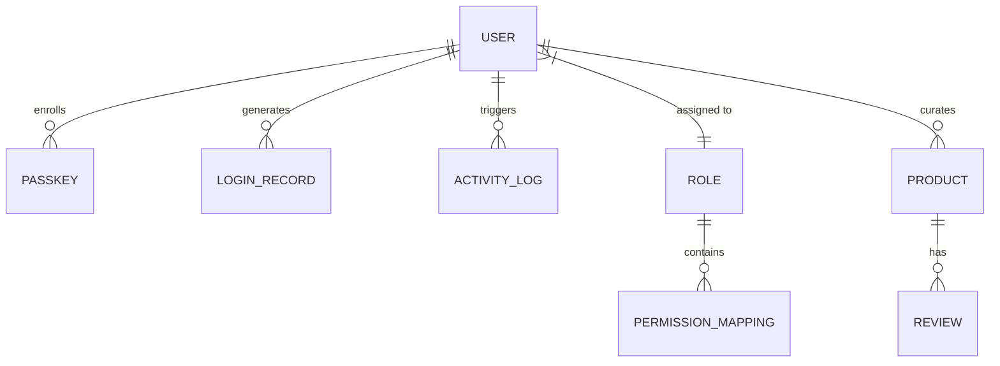

# Data Model & Schema Specifications

## 1. Entity-Relationship Overview

The system manages four primary entities: **Users**, **Roles & Permissions**, **Catalog Products**, and **Audit Logs**. All entities are typed and stored with local-first persistence guarantees.



---

## 2. Entity Schemas

### 2.1. User Entity (`User`)

Represents an authenticated team colleague in the system.

```typescript
interface User {
  id: string;                      // Unique identifier, e.g. "usr_admin_01"
  name: string;                    // Human display name, e.g. "Sarah Connor"
  email: string;                   // Corporate email, e.g. "admin@enterprise.com"
  role: 'Admin' | 'Manager' | 'Employee'; // Core RBAC tier
  department: string;              // Organization unit, e.g. "Executive Leadership"
  title: string;                   // Human title, e.g. "Director of Operations"
  avatar: string;                  // HTTPS URL to human colleague photo
  password?: string;               // Hashed / plain representation for demo auth
  passkeys: PasskeyCredential[];   // Registered biometric hardware credentials
  createdAt: string;               // ISO 8601 timestamp
}
```

### 2.2. Passkey Credential Entity (`PasskeyCredential`)

Stores metadata for enrolled WebAuthn / FIDO2 authenticators.

```typescript
interface PasskeyCredential {
  id: string;                      // Base64URL encoded credential ID
  name: string;                    // Human label, e.g. "Sarah's ThinkPad Windows Hello"
  authenticatorType: string;       // "Windows Hello (Face / PIN)" | "Fingerprint Biometrics"
  createdAt: string;               // ISO 8601 timestamp
  lastUsedAt?: string;             // ISO 8601 timestamp
  verified: boolean;               // Hardware attestation status
  isSimulated?: boolean;           // True if generated via test simulation bypass
}
```

### 2.3. Role & Permission Matrix (`PermissionMatrix`)

Defines the capabilities granted to each organizational tier.

```typescript
// Core Role Identifiers
type Role = 'Admin' | 'Manager' | 'Employee';

// Permission Identifiers
type PermissionKey =
  | 'dashboard.view'
  | 'analytics.view'
  | 'records.view'
  | 'records.create'
  | 'records.edit'
  | 'records.delete'
  | 'reports.view'
  | 'settings.manage'
  | 'profile.view';

// Dynamic Permission Matrix
type PermissionMatrix = {
  [key in Role]: {
    [key in PermissionKey]: boolean;
  };
};
```

#### Permission Definition Metadata (`PermissionDefinition`)

```typescript
interface PermissionDefinition {
  key: PermissionKey;              // Unique dot-notated permission identifier
  label: string;                   // Human-readable action name
  category: string;                // Module grouping, e.g. "Catalog Operations"
  description: string;             // Technical description
  humanQuestion: string;           // Conversational question for Admin matrix UI
}
```

### 2.4. Product Catalog Entity (`Product`)

Represents a product item retrieved from the REST API or created by colleagues.

```typescript
interface Product {
  id: number;                      // Numeric ID from REST API or Date.now() timestamp
  title: string;                   // Product name
  description: string;             // Detailed product specifications
  category: string;                // Category / Department slug, e.g. "beauty", "smartphones"
  price: number;                   // Retail price in USD
  discountPercentage?: number;     // Active promotional discount (0-100)
  rating?: number;                 // Customer satisfaction score (1.0 - 5.0)
  stock: number;                   // Available inventory quantity
  tags?: string[];                 // Search tags, e.g. ["headphones", "audio"]
  brand?: string;                  // Manufacturer or brand name
  sku?: string;                    // Stock Keeping Unit identifier
  weight?: number;                 // Weight in kilograms
  dimensions?: {
    width: number;                 // Width in centimeters
    height: number;                // Height in centimeters
    depth: number;                 // Depth in centimeters
  };
  warrantyInformation?: string;    // e.g. "1 year limited manufacturer warranty"
  shippingInformation?: string;    // e.g. "Ships in 2-3 business days"
  availabilityStatus?: string;     // e.g. "In Stock" | "Low Stock" | "Out of Stock"
  reviews?: ProductReview[];       // Customer and colleague review list
  returnPolicy?: string;           // e.g. "30 days return policy"
  minimumOrderQuantity?: number;   // Minimum batch procurement quantity
  meta?: {
    barcode?: string;              // Standard EAN / UPC barcode number
    qrCode?: string;               // QR verification link
    createdAt?: string;            // ISO timestamp
    updatedAt?: string;            // ISO timestamp
  };
  images?: string[];               // High-resolution image URLs
  thumbnail: string;               // Primary display image URL
  isCustom?: boolean;              // True if added via the application UI
  curatorId?: string;              // Attributed colleague user ID
}
```

### 2.5. Product Review Entity (`ProductReview`)

```typescript
interface ProductReview {
  rating: number;                  // Integer 1 - 5
  comment: string;                 // Reviewer text testimonial
  date: string;                    // ISO 8601 timestamp
  reviewerName: string;            // Display name of reviewer
  reviewerEmail: string;           // Contact email
}
```

### 2.6. Colleague Activity & Audit Log (`ActivityLog`)

```typescript
interface ActivityLog {
  id: string;                      // Unique log ID, e.g. "log_173000000"
  timestamp: string;               // ISO 8601 timestamp
  user: string;                    // Name of acting colleague
  role: Role;                      // Role tier at time of action
  action: string;                  // Action label, e.g. "Updated Permission Matrix"
  details: string;                 // Conversational description of change
  type: 'security' | 'catalog' | 'system' | 'auth'; // Categorization
}
```

### 2.7. Sign-In History Record (`LoginRecord`)

```typescript
interface LoginRecord {
  id: string;                      // Unique session log ID
  userName: string;                // Colleague name
  email: string;                   // Colleague email
  role: Role;                      // Role logged in as
  method: 'Password' | 'Windows Hello Face' | 'Fingerprint Biometrics';
  browser: string;                 // Detected user agent, e.g. "Chrome 122 on Windows"
  timestamp: string;               // ISO 8601 timestamp
  status: string;                  // "Success (Biometric Verified)" | "Success (Password)"
}
```

---

## 3. LocalStorage Key Contracts

All client state is synchronized across browser sessions and tabs using standardized keys:

| LocalStorage Key | Entity Stored | Purpose & Lifecycle |
| :--- | :--- | :--- |
| `rbac_auth_user` | `User` | Active authenticated colleague session. |
| `rbac_users_list` | `User[]` | Registered colleague accounts and passkeys. |
| `rbac_login_history` | `LoginRecord[]` | Audit trail of previous logins. |
| `rbac_permissions` | `PermissionMatrix` | Runtime permission matrix overrides. |
| `rbac_activity_logs` | `ActivityLog[]` | Real-time colleague action feed. |
| `rbac_custom_products` | `Product[]` | Products created by users via POST. |
| `rbac_updated_products`| `Record<number, Partial<Product>>` | Local overrides for edited products. |
| `rbac_deleted_product_ids` | `number[]` | IDs of removed products. |
| `rbac_theme` | `'light' \| 'dark' \| 'system'` | User visual appearance preference. |

