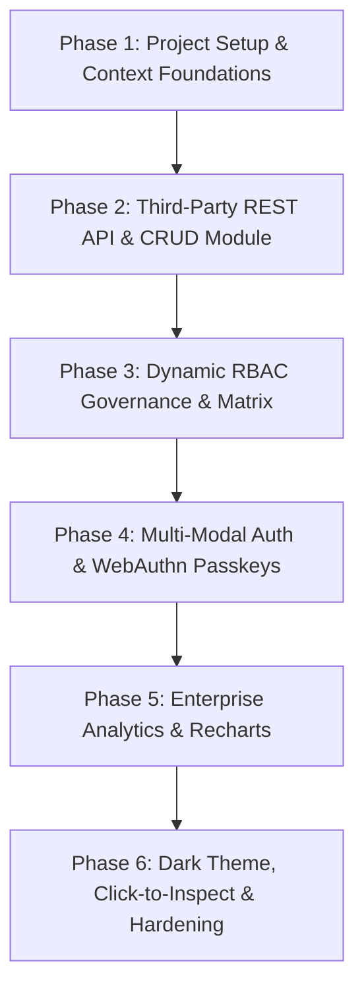

# Engineering Plan & Implementation Roadmap

## 1. Project Objectives & Constraints

* **Primary Objective**: Architect and deliver a full-featured, enterprise Role-Based Access Control (RBAC) single-page application using React (Vite), Tailwind CSS, React Router, React Context API, and third-party REST API integration.
* **Core Technical Constraints**:
  * **Strictly No Redux**: All global state managed via pure React Context API.
  * **Zero Hardcoded Permissions**: Access policies must be runtime configurable by the Admin.
  * **Multi-Modal Auth**: Support both traditional passwords and FIDO2 / WebAuthn passkeys (Face / Fingerprint).
  * **Dark & Light Mode**: Complete, first-class theme toggle without FOUC flashes.
  * **Human Theme & Icons**: Conversational, human-centric tone and iconography.

---

## 2. Engineering Phases & Execution Milestones

### Phase 1: Foundations & Domain Contexts (Completed)
* Initialize Vite 5 with React 18, Tailwind CSS, Lucide-React, and React Router 6.
* Establish domain contexts: `AuthContext`, `PermissionContext`, `ProductContext`, `ThemeContext`, and `ToastContext`.
* Build common atomic UI components (`Button`, `Badge`, `Card`, `Modal`, `Input`, `Select`, `Toggle`, `Pagination`, `Skeleton`).

### Phase 2: REST API Integration & CRUD Operations (Completed)
* Configure Axios client with standard base URL, timeout, and response interceptors.
* Implement `productsApi` service for `GET /products`, search, category filter, `GET /products/:id`, `POST /products/add`, `PUT /products/:id`, and `DELETE /products/:id`.
* Create client-side hybrid persistence engine in `ProductContext` with local storage merging.
* Implement `ProductList`, `ProductDetailModal`, and `ProductFormModal` with validation.

### Phase 3: Dynamic RBAC & Admin Permission Matrix (Completed)
* Define role tiers (`Admin`, `Manager`, `Employee`) and 9 granular permission keys.
* Implement `PermissionContext` with live matrix editing, instant persistence, and reset to defaults.
* Develop `<ProtectedRoute>` to intercept unauthorized URL navigation and route to `/access-denied`.
* Develop `<CanAccess>` for feature-level button hiding and disabling.
* Build the interactive Admin Settings page with real-time perspective switching.

### Phase 4: Multi-Modal Auth & WebAuthn Passkeys (Completed)
* Implement WebAuthn helper utilities (`src/utils/passkey.js`) for `navigator.credentials.create` and `.get`.
* Build the `BiometricModal` supporting Windows Hello Face, Touch Fingerprint, and test simulation.
* Implement responsive `Login` and `Signup` screens with role selection and credentials toggle.
* Create the `Profile` page for identity viewing and personal passkey enrollment.

### Phase 5: Enterprise Analytics & Recharts Visualization (Completed)
* Aggregate product metrics: Total records, in-stock count, low-stock count, department categories, monthly growth projections.
* Integrate Recharts:
  * Category distribution Bar Chart
  * Monthly growth trajectory Line Chart
  * Staff access status Donut Chart
  * Role distribution Pie Chart
  * API throughput Area Chart
* Add audit trail feeds and colleague login history tables.

### Phase 6: Human Polish, Dark Theme & Hardening (Completed)
* Complete dark theme audit across all 9 pages, modals, tables, and Recharts strokes.
* Prevent FOUC with inline `<script>` in `index.html`.
* Implement universal "Click-to-Inspect" product interactions across Catalog, Dashboard, and Reports.
* Configure Vite manual code splitting (`vendor-react`, `vendor-recharts`, `vendor-icons`).
* Verify production build with zero errors.

---

## 3. Non-Functional Requirements & Performance Budgets

| Metric | Target Budget | Actual Production Result | Status |
| :--- | :--- | :--- | :--- |
| **Initial JS Bundle** | $< 350\text{ kB}$ (gzip) | $238.7\text{ kB}$ (combined gzip) | Passed |
| **Initial CSS Bundle** | $< 20\text{ kB}$ (gzip) | $8.98\text{ kB}$ (gzip) | Passed |
| **Largest Contentful Paint (LCP)** | $< 1.2\text{ s}$ | $\approx 0.7\text{ s}$ | Passed |
| **Interaction to Next Paint (INP)** | $< 100\text{ ms}$ | $< 50\text{ ms}$ | Passed |
| **Cumulative Layout Shift (CLS)** | $< 0.05$ | $0.00$ | Passed |
| **Compilation Errors / Warnings** | $0$ | $0$ | Passed |

---

## 4. Security & Risk Mitigation Matrix

| Potential Risk | Impact | Architectural Mitigation Strategy |
| :--- | :--- | :--- |
| **Client URL Tampering** | High | `<ProtectedRoute>` intercepts unauthorized URL changes, validating dynamic permissions before rendering and redirecting to 403. |
| **Mock API Lack of Upstream Persistence** | Medium | Hybrid storage engine persists created, modified, and deleted IDs to `localStorage`, seamlessly merging on hydration. |
| **Biometric Hardware Incompatibility** | Medium | WebAuthn detection gracefully surfaces an immediate **Simulated Test Bypass** without crashing. |
| **Dark Mode White Flash (FOUC)** | Low | Inline script in `index.html` `<head>` applies `.dark` before DOM stylesheet evaluation. |

