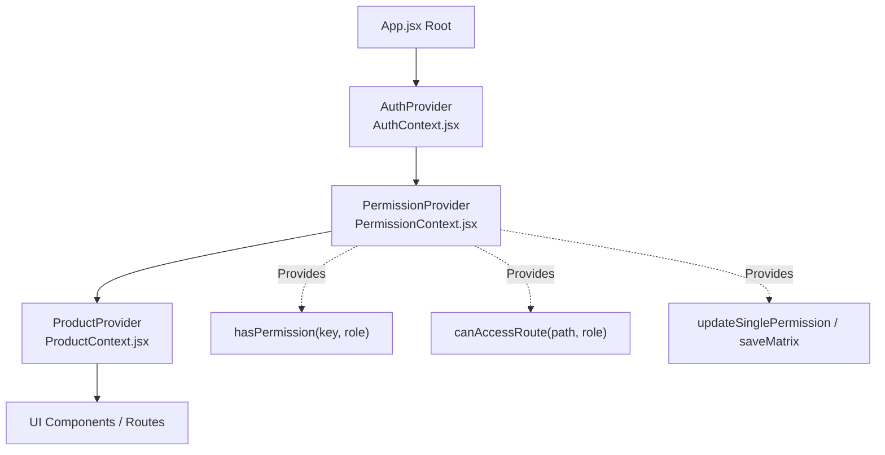

# Module 4: Dynamic Role-Based Access Control (RBAC)

## 1. Overview & Objective
Dynamic Role-Based Access Control is the core architectural foundation of this system. Access rules, visible menu navigation, and operational buttons are **never hardcoded** in static route guards or component logic. Instead, privileges are evaluated dynamically at runtime from an active permission matrix managed via React Context.

---

## 2. The Three Organizational Roles

| Role Key | Human Role Title | Default Scope | Dynamic Governance |
| :--- | :--- | :--- | :--- |
| **`Admin`** | **Lead Executive Administrator** | Universal access to all modules, complete CRUD actions, governance settings, and audit logs. | Unrestricted baseline. Serves as the system overseer and permission authority. |
| **`Manager`** | **Team Operations Manager** | Oversight of day-to-day catalog operations, analytics, reporting, and item editing. | Controlled dynamically through Admin Settings. Permissions can be granted or revoked at any time. |
| **`Employee`** | **Colleague & Operations Specialist** | Focused task-oriented execution (viewing records, viewing basic dashboards, managing personal profile). | Fully governed by Admin Settings. Can be elevated to perform creations, edits, or reports on demand. |

---

## 3. Architecture: Pure React Context API (Zero Redux)

The system replaces heavy boilerplate (Redux, Redux Toolkit, Thunk) with high-performance React Context providers:



### 3.1 Permission Resolution Pipeline
When a component or route queries whether a user is authorized:
1. The component calls `hasPermission(permissionKey, currentUser.role)`.
2. **Admin Override**: If `role === 'Admin'`, the function immediately returns `true`.
3. **Dynamic Lookup**: For `Manager` and `Employee`, the function checks the active permission matrix state:
   ```javascript
   const hasPermission = (permissionKey, userRole) => {
     if (!userRole) return false;
     if (userRole === ROLES.ADMIN) return true;
     return !!permissions[userRole]?.[permissionKey];
   };
   ```
4. **Reactive Re-render**: If the Admin toggles a permission switch in Admin Settings and saves, the `permissions` state updates in `PermissionContext`. Every mounted component subscribing to `usePermission()` re-renders instantly with the new privilege.

---

## 4. Permission Taxonomy & Matrix Keys

The system defines 9 granular operational permissions:

```javascript
export const PERMISSIONS = {
  DASHBOARD: 'dashboard.view',         // Access to executive summary & KPIs
  ANALYTICS: 'analytics.view',         // Access to visual Recharts analytics
  VIEW_RECORDS: 'records.view',        // Access to product catalog & search
  CREATE_RECORDS: 'records.create',    // Ability to add new products
  EDIT_RECORDS: 'records.edit',        // Ability to modify existing products
  DELETE_RECORDS: 'records.delete',    // Ability to permanently remove products
  REPORTS: 'reports.view',             // Access to inventory valuation & CSV export
  SETTINGS: 'settings.manage',         // Access to Admin Settings & RBAC matrix
  PROFILE: 'profile.view',             // Access to colleague profile & passkeys
};
```

### 4.1 Default Permission Matrix
Below is the default operational baseline established on first run:

| Module / Permission | Admin | Manager | Employee |
| :--- | :---: | :---: | :---: |
| **Dashboard** (`dashboard.view`) | :white_check_mark: | :white_check_mark: | :white_check_mark: |
| **Analytics Dashboard** (`analytics.view`) | :white_check_mark: | :white_check_mark: | :white_check_mark: |
| **View Records** (`records.view`) | :white_check_mark: | :white_check_mark: | :white_check_mark: |
| **Create Records** (`records.create`) | :white_check_mark: | :white_check_mark: | :x: |
| **Edit Records** (`records.edit`) | :white_check_mark: | :white_check_mark: | :x: |
| **Delete Records** (`records.delete`) | :white_check_mark: | :x: | :x: |
| **Reports** (`reports.view`) | :white_check_mark: | :white_check_mark: | :x: |
| **Settings** (`settings.manage`) | :white_check_mark: | :x: | :x: |
| **Profile** (`profile.view`) | :white_check_mark: | :white_check_mark: | :white_check_mark: |

---

## 5. Security & Runtime Enforcement

### 5.1 Route-Level Enforcement (`<ProtectedRoute />`)
Prevents unauthorized page access even if an unauthorized colleague manually enters a direct URL into the browser address bar:
```jsx
<ProtectedRoute requiredPermission={PERMISSIONS.ANALYTICS}>
  <Analytics />
</ProtectedRoute>
```
If `hasPermission(PERMISSIONS.ANALYTICS, role)` evaluates to `false`, the user is immediately redirected to `/access-denied` (HTTP 403 Forbidden).

### 5.2 Feature-Level Enforcement (`<CanAccess />`)
Guards individual operational buttons and controls inside page components:
```jsx
<CanAccess permission={PERMISSIONS.CREATE_RECORDS}>
  <Button onClick={() => setIsCreateOpen(true)}>
    Add New Product
  </Button>
</CanAccess>
```
When permission is disabled, the button is completely excluded from the DOM.

---

## 6. Step-by-Step Evaluation Guide
1. Log in as **Sarah Connor** (`admin@enterprise.com`).
2. Navigate to **Admin Settings** (`/admin/settings`).
3. Under the **Permission Matrix**, locate the **Manager** column and toggle **Delete Records** to **ON** (:white_check_mark:).
4. Click **Save Permission Matrix**.
5. Log out and sign in as **Marcus Vance** (`manager@enterprise.com`).
6. Navigate to **Product Records** (`/products`). Verify that the trash can (Delete) button is now visible and active for Marcus.
7. Return to Sarah’s account, revoke Marcus’s Delete permission, click Save, and verify the delete button immediately disappears from Marcus’s view.
