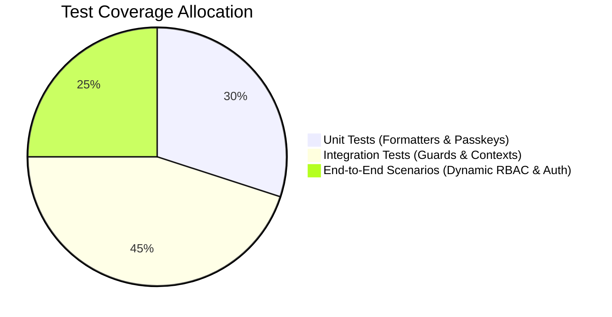

# Technical Design Document & Test Strategy (TDD)

## 1. Technical Design Overview

The **Dynamic Role-Based Access Management System** solves two key technical challenges:
1. **Runtime Permission Evaluation**: Guaranteeing that access decisions are calculated deterministically in memory on every render cycle without incurring network latency or component unmounting flicker.
2. **State Synchronization Without Redux**: Coordinating 5 domain contexts (Auth, Permissions, Products, Theme, Toasts) cleanly using React's native composition model.

---

## 2. State Architecture: React Context vs. Redux Trade-Offs

| Decision Vector | React Context API (Chosen) | Redux / RTK (Rejected) |
| :--- | :--- | :--- |
| **Architectural Mandate** | Explicit project requirement: *"React Context API (Strictly No Redux)"*. | Disqualified by architectural guidelines. |
| **Bundle Footprint** | $0\text{ kB}$ additional runtime overhead. | $\sim 15 - 25\text{ kB}$ additional bundle size. |
| **Separation of Domains** | 5 discrete, decoupled contexts (`Auth`, `Permission`, `Product`, `Theme`, `Toast`). | Monolithic global store or complex slice configurations. |
| **Boilerplate** | Clean custom hooks (`useAuth()`, `usePermission()`, `useProduct()`, `useTheme()`). | Actions, reducers, dispatchers, and selectors. |
| **Re-render Optimization** | Domain-isolated renders; modifying permissions does not re-render unrelated product rows. | Requires `reselect` memoization. |

---

## 3. Test Strategy & Coverage Matrix

### 3.1. Unit Test Specifications

#### Suite 1: Utility Formatters ([`src/utils/formatters.js`](file:///f:/dynamic-rbac-system/src/utils/formatters.js))
* **`formatCurrency(amount)`**:
  * Input: `299.99` $\rightarrow$ Output: `"$299.99"`.
  * Input: `0` $\rightarrow$ Output: `"$0.00"`.
  * Handles invalid numbers gracefully.
* **`formatNumber(num)`**:
  * Input: `1420` $\rightarrow$ Output: `"1,420"`.
* **`getHumanStockStatus(stock)`**:
  * Stock $> 10 \rightarrow$ Label: `"Abundant Stock"`, class: `bg-emerald-50 text-emerald-700`.
  * $0 < \text{Stock} \le 10 \rightarrow$ Label: `"Low Stock"`, class: `bg-amber-50 text-amber-700`.
  * $\text{Stock} \le 0 \rightarrow$ Label: `"Out of Stock"`, class: `bg-rose-50 text-rose-700`.

#### Suite 2: Passkey & Base64URL Helpers ([`src/utils/passkey.js`](file:///f:/dynamic-rbac-system/src/utils/passkey.js))
* **`bufferToBase64Url(buffer)`**:
  * Converts an `ArrayBuffer` into URL-safe base64 without padding (`+` $\rightarrow$ `-`, `/` $\rightarrow$ `_`, removes `=`).
* **`base64UrlToBuffer(base64url)`**:
  * Inverse decode verifying round-trip equality.
* **`isWebAuthnSupported()`**:
  * Detects `window.PublicKeyCredential` presence.

---

### 3.2. Integration Test Specifications

#### Suite 3: Security Guard `<CanAccess>` ([`src/components/rbac/CanAccess.jsx`](file:///f:/dynamic-rbac-system/src/components/rbac/CanAccess.jsx))
* **Test Case 3.1**: When permission is granted, renders child components (`<Button>`).
* **Test Case 3.2**: When permission is restricted, renders `fallback` or returns `null`.
* **Test Case 3.3**: When `renderDisabled` is true, renders disabled child with warning tooltip.

#### Suite 4: Route Guard `<ProtectedRoute>` ([`src/components/rbac/ProtectedRoute.jsx`](file:///f:/dynamic-rbac-system/src/components/rbac/ProtectedRoute.jsx))
* **Test Case 4.1**: Unauthenticated user $\rightarrow$ Redirects to `/login`.
* **Test Case 4.2**: Admin user $\rightarrow$ Grants access unconditionally.
* **Test Case 4.3**: Non-Admin user accessing admin-only route $\rightarrow$ Redirects to `/access-denied` with diagnostic state.
* **Test Case 4.4**: User missing dynamic permission $\rightarrow$ Redirects to `/access-denied`.

#### Suite 5: Dynamic Permission Management ([`src/context/PermissionContext.jsx`](file:///f:/dynamic-rbac-system/src/context/PermissionContext.jsx))
* **Test Case 5.1**: `hasPermission(PERMISSIONS.DELETE_RECORDS, ROLES.MANAGER)` initially returns `false`.
* **Test Case 5.2**: Update matrix to grant `delete` to Manager $\rightarrow$ `hasPermission` immediately returns `true`.
* **Test Case 5.3**: `resetToDefaults()` restores initial mapping.

---

### 3.3. End-to-End (E2E) Test Scenarios

#### Scenario 1: Runtime Permission Propagation (The Golden Flow)
1. **Given** Sarah (Admin) is logged in.
2. **When** Sarah navigates to Admin Settings and toggles "Create Records" for Specialists to ON.
3. **And** clicks "Save Permission Settings".
4. **And** switches role to Elena (Specialist).
5. **Then** the "Add New Product" button in Curated Catalog becomes visible and interactive.
6. **When** Sarah toggles "Create Records" back to OFF and saves.
7. **Then** the "Add New Product" button disappears from Elena's view immediately without page refresh.

#### Scenario 2: URL Tampering Interception
1. **Given** Elena (Specialist) is logged in.
2. **When** Elena manually enters `http://localhost:5173/admin/settings` into the browser bar.
3. **Then** the application intercepts navigation and renders `/access-denied`.
4. **And** the page displays:
   * Colleague Role: `Employee (Specialist Operations)`
   * Attempted Section: `/admin/settings`
   * Governing Policy: `Administrator Privileges`
   * Shortcut button: `Switch to Sarah (Admin) to adjust permissions`.

#### Scenario 3: Complete REST API CRUD Lifecycle
1. **Create**: User submits new product via modal $\rightarrow$ dispatches `POST /products/add` $\rightarrow$ item appears in catalog with "User Added" badge.
2. **Read**: User clicks product card/row $\rightarrow$ modal displays full 3-tab details and customer reviews.
3. **Update**: User edits title and price $\rightarrow$ dispatches `PUT /products/:id` $\rightarrow$ table displays updated values.
4. **Delete**: User clicks delete $\rightarrow$ confirmation modal dispatches `DELETE /products/:id` $\rightarrow$ item is removed from table and valuation totals update.

---

## 4. Threat Modeling & Security Analysis

| Threat | Attack Vector | Countermeasure Implemented |
| :--- | :--- | :--- |
| **Privilege Escalation via URL** | Attacker manually types `/admin/settings` in browser. | `<ProtectedRoute>` performs serverless client-side authorization check before loading page chunk. |
| **State Tampering via LocalStorage** | User manually alters role key in DevTools. | `AuthContext` validates schema against valid roles and re-evaluates permissions dynamically on every route shift. |
| **Credential Replay Attack** | Interception of biometric credential. | WebAuthn utilizes public-key cryptography with unique cryptographic challenges; raw biometric data never leaves hardware enclave. |
| **Cross-Site Scripting (XSS)** | Injection of script via product review or title. | React JSX automatically encodes content; all inputs are sanitized and rendered as text nodes. |

