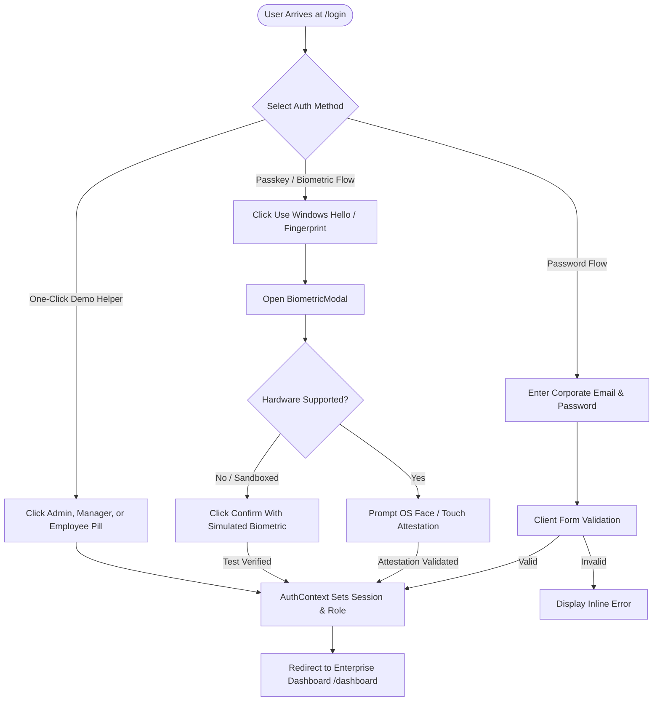
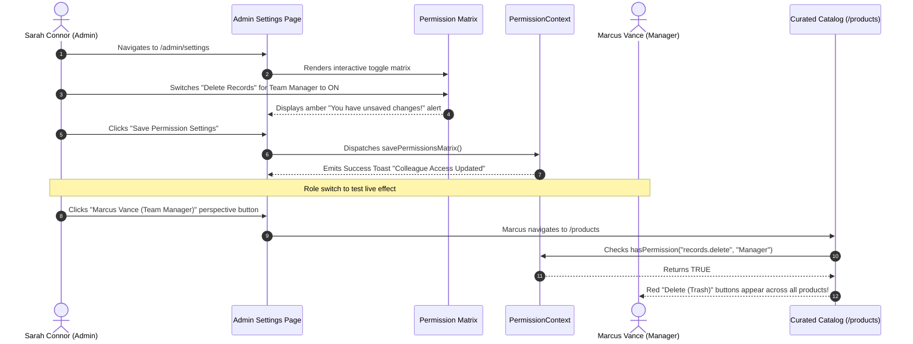
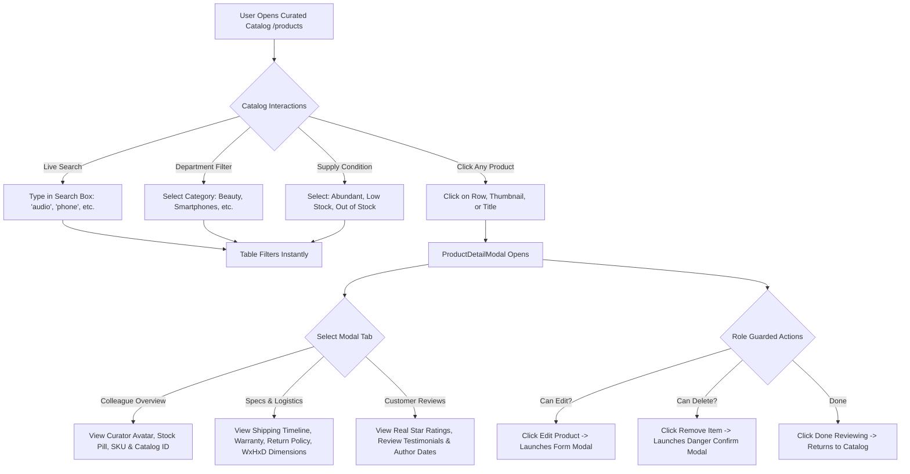
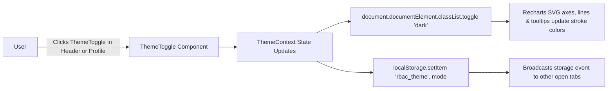

# User Flow & Interaction Journey Specifications

## 1. User Journey 1: Authentication & Biometric Sign-In



---

## 2. User Journey 2: Admin Dynamic Permission Governance



---

## 3. User Journey 3: Catalog Exploration & Click-to-Inspect



---

## 4. User Journey 4: Unauthorized Access Interception (403 Flow)

```mermaid
flowchart TD
    User[Elena Rostova (Specialist)] --> Action[Manually Types /admin/settings in URL Bar]
    Action --> RouteGuard[ProtectedRoute Component Evaluates Access]
    RouteGuard --> AuthCheck{Is User Admin?}
    AuthCheck -->|No| Block[Block Navigation]
    Block --> Redirect[Redirect to /access-denied with State Metadata]
    
    Redirect --> Empathetic403[Render Human Empathetic 403 Page]
    Empathetic403 --> Info1[Role: Employee Specialist Operations]
    Empathetic403 --> Info2[Attempted Path: /admin/settings]
    Empathetic403 --> Info3[Governing Policy: Administrator Privileges]
    
    Empathetic403 --> Choices{User Action}
    Choices -->|Go Back| Previous[Returns to Previous Page]
    Choices -->|Back to Overview| Home[Navigates to /dashboard]
    Choices -->|Testing Shortcut| SwapAdmin[Click Switch to Sarah Admin -> Navigates to Admin Settings]
```

---

## 5. User Journey 5: Theme Switching (Light $\leftrightarrow$ Dark $\leftrightarrow$ System)



